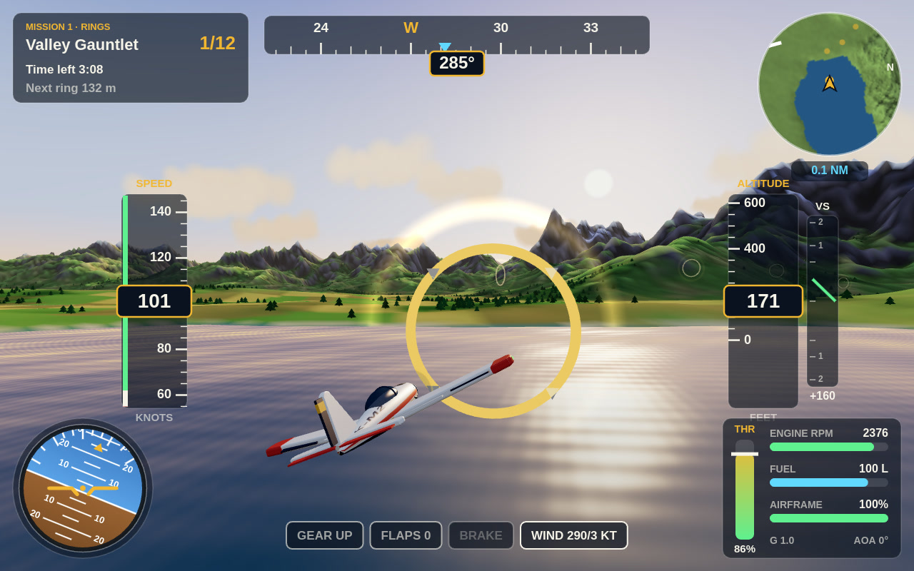

[](https://make.fun/bounty/best-flight-game-20261126-0057)
[](https://make.fun/bounty/best-flight-game-20261126-0057)
[](https://make.fun/bounty/best-flight-game-20261126-0057)

# Skylark Valley

A light-aircraft flying game in the browser. You fly the **Merrow M-2 Skylark**, a two-seat
low-wing trainer, around the Lake Ondine basin: a big blue lake, farm patchwork on the southern
plain, pine forests, the snow-capped Corran Peaks and the winding Kestrel Gorge. Skim rings across the
water at sunset, haul supplies up to a mountain strip on half a tank, and grease a crosswind landing at
last light. Every landing is graded on how softly you touched down, how close to the centreline, and
whether you stopped on the runway.



## Missions

1. **Valley Gauntlet** (golden hour): twelve rings against the clock. Two hang low over Lake Ondine
   toward the setting sun, then ten wind up Kestrel Gorge. Scored on rings threaded, time left and how
   intact the airframe is.
2. **Hawthorn Supply Run** (morning): take off from Vessel Field with under half a tank and land on
   Hawthorn Strip, 4.2 NM north-west and 1,400 ft up. Burn too much fuel climbing and the engine quits.
   Scored on the landing plus the fuel you have left.
3. **Dusk Crosswind** (dusk): a two-mile final to Vessel Field runway 36 in a gusting 15-knot
   crosswind, with edge lights, sequenced approach lights and a live PAPI. Scored on the landing grade.
4. **Free Flight**: full tank, no clock; tour the valley, then land at either field for a grade.

Results show stars (one to three) and a full score breakdown; best scores are kept per mission.

## Controls

| Key | Action |
| --- | --- |
| W / S or Up / Down | Nose down / nose up |
| A / D or Left / Right | Roll left / right |
| Q / E | Rudder |
| Shift / Ctrl, or + / - | Throttle up / down |
| F | Flaps 0 / 15 / 30 |
| G | Gear up / down |
| B or Space | Brakes |
| C | Chase / cockpit view |
| Mouse drag | Look around |
| Esc / P | Pause |
| R | Restart mission |
| M | Mission menu |

## Flying it

Lift grows with the square of airspeed and with angle of attack, until the wing stalls (horn, flashing
STALL, nose drops). Throttle is inertial: the engine spools toward the lever. Flaps add lift and drag,
the gear adds drag, and there is ground effect in the last few metres. Fuel burns faster at high power.
Firm landings, scrapes and rough fields cost airframe health; a hard enough hit, a dragged wingtip or a
ditching ends the flight, and the crash screen says exactly what happened.

A good approach in the Skylark: about 60–65 knots, flaps 30, gear down, a 3° glidepath (the HUD shows
LOW / ON GLIDEPATH / HIGH, the PAPI shows two white and two red), power to idle over the threshold, ease
back to flare, and brake once all three wheels are down.

## Running it

The game is static files in `game/` with three.js vendored under `game/vendor/three/`. Serve the folder
with any static server and open `index.html`:

```sh
node serve.ts --port 8731      # then open http://127.0.0.1:8731/
```

Screenshot mode renders one fixed frame: `index.html?shot=cover`, `?shot=approach`, `?shot=cockpit`,
`?shot=menu`. `tools/capture-shots.sh` renders all four with headless Chromium (SwiftShader) and
writes the JPEGs in `screenshots/`.

`main.ts` (Node 22, no dependencies) copies `game/` and `screenshots/` into `$MAKEFUN_OUTPUT_DIR`
(default `/output`) and writes `dossier.json` there.

## Code map

- `game/src/flight-model.js`: forces, stall, engine and fuel, gusting wind, ground roll, damage and crashes
- `game/src/world-map.js`: the analytic geography shared by rendering, physics and the minimap
- `game/src/terrain.js`, `forest.js`, `water.js`, `sky.js`, `runway.js`: the world
- `game/src/aircraft-model.js`: the Skylark with moving controls, prop and retractable gear
- `game/src/missions.js`: the four missions, landing grading and scoring
- `game/src/hud.js`, `cockpit-panel.js`: chase HUD and cockpit instruments
- `game/src/audio.js`: synthesised engine, wind, stall horn, chimes and crashes
- `game/src/main.js`: boot and frame loop

## License

MIT. three.js is MIT-licensed by its authors.
